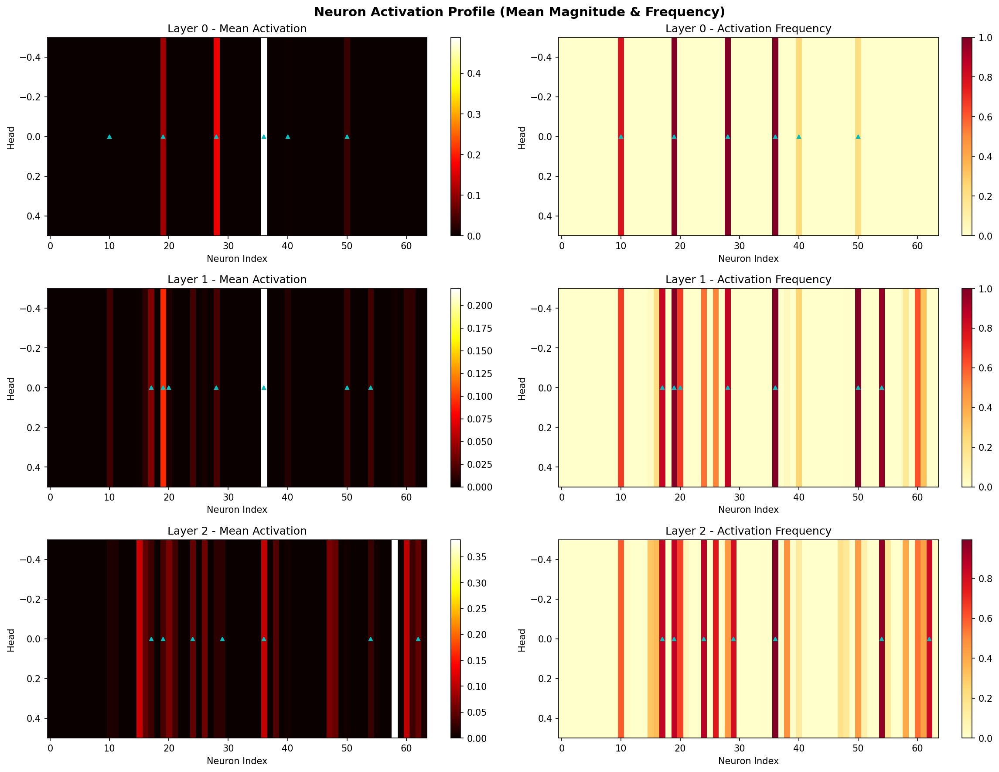
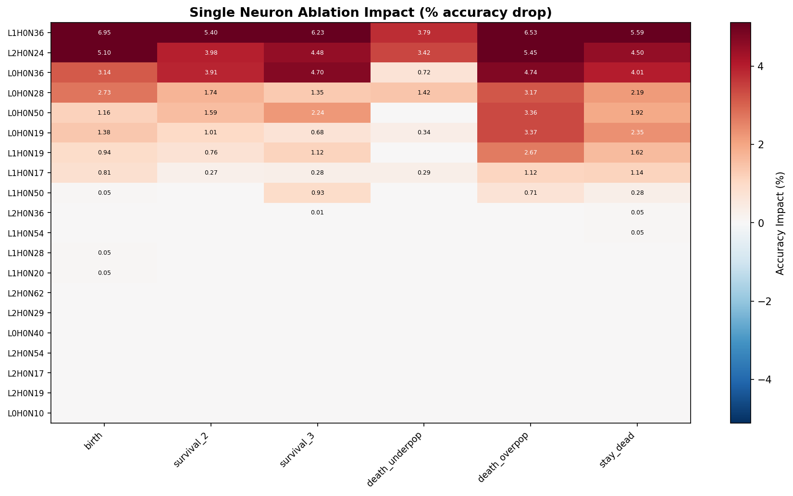
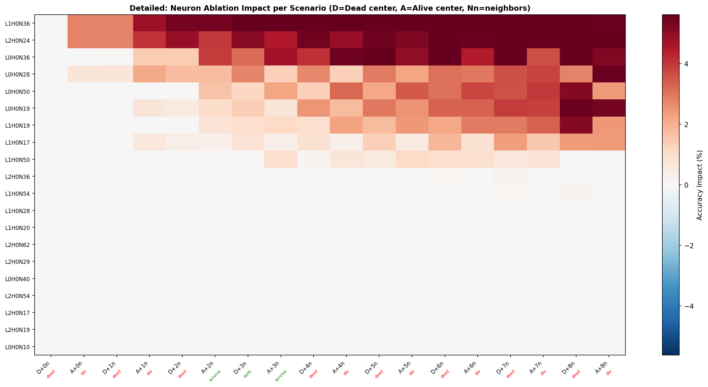
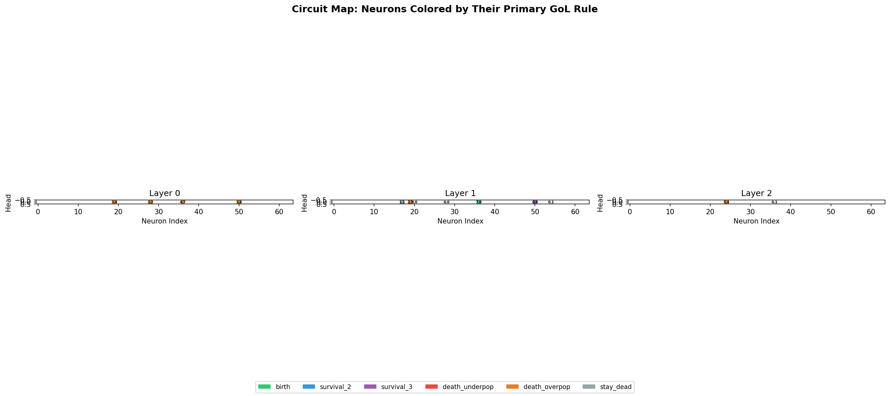
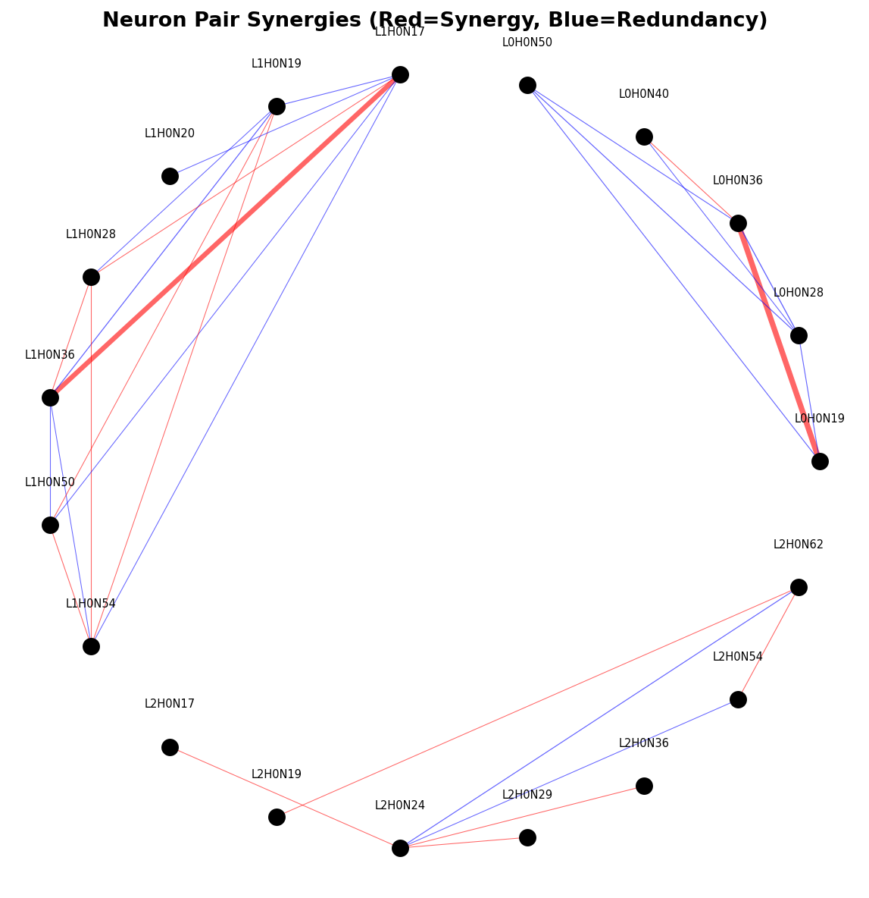
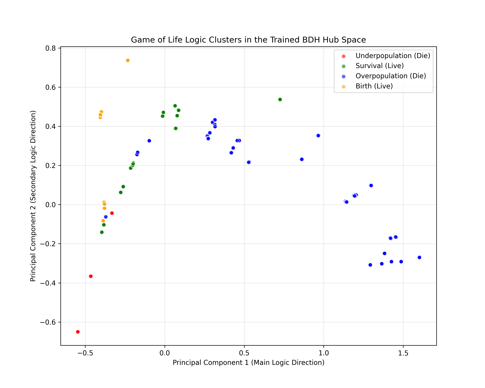

<](#)
[](https://huggingface.co/spaces/YOUR_USERNAME/bdh-game-of-life)
[](LICENSE)

**Team:** `[Team Member 1]` · `[Team Member 2]` · `[Team Member 3]`

</div>

---

## Table of Contents

1. [Introduction & The BDH Advantage](#1-introduction--the-bdh-advantage)
2. [Architecture Overview](#2-architecture-overview)
3. [Monosemanticity & Sparse Activations](#3-monosemanticity--sparse-activations)
4. [Rigorous Ablation Study](#4-rigorous-ablation-study)
5. [Emergent Graph Topology & Synergy Networks](#5-emergent-graph-topology--synergy-networks)
6. [Interpretable Reasoning Chains](#6-interpretable-reasoning-chains)
7. [PCA & Activation Atlas](#7-pca--activation-atlas)
8. [The Dimensionality Probe (Exhaustive Search)](#8-the-dimensionality-probe-exhaustive-search)
9. [Interactive Visualizer](#9-interactive-visualizer-visualizepy)
10. [Reproduction & Setup](#10-reproduction--setup)
11. [Limitations & Future Scope](#11-limitations--future-scope)
12. [References](#12-references)

---

## 1. Introduction & The BDH Advantage

Conway's Game of Life is a deceptively simple cellular automaton governed by four deterministic rules applied to a binary grid: a dead cell with **exactly 3** live neighbors is **born**; a live cell with **2 or 3** neighbors **survives**; all other live cells **die** (from underpopulation or overpopulation); and all other dead cells **stay dead**. Despite the simplicity of these rules, predicting even a single step requires a non-trivial computation: counting neighbors, checking the center cell's own state, and applying a piecewise-linear decision boundary. This makes Game of Life an ideal benchmark for mechanistic interpretability — the ground truth is fully known, yet the model must learn a genuinely non-trivial algorithm.

We train a **Baby Dragon Hatchling (BDH)** network — a sparse, graph-based architecture — to predict the next state of a 12×12 padded Game of Life grid with **100% accuracy** on random boards. We then disassemble the trained model neuron by neuron, proving that BDH's internal representations are not opaque matrices of entangled features, but **clean, interpretable circuits** that map directly to the logical rules of the game.

### Why BDH, Not a Transformer?

The dominant paradigm in mechanistic interpretability is reverse-engineering dense Transformers, where features are superposed across neurons and require expensive Sparse Autoencoder (SAE) extraction. BDH offers a fundamentally different paradigm:

| Property | Dense Transformer | BDH Architecture |
|---|---|---|
| Neuron Activation | Dense — most neurons fire | **Extremely Sparse** — ~5–10% fire |
| Feature Encoding | Superposition (polysemantic) | **Monosemantic by construction** |
| Interpretability Method | Post-hoc SAEs, costly probes | **Direct inspection of sparse hubs** |
| Attention Mechanism | Softmax over dense embeddings | RoPE-2D over **sparse spatial hubs** |
| Computation Graph | Residual stream + MLP | Encoder → Sparse Hub → Gated Product → Decoder |

BDH does not require Sparse Autoencoders to extract features because its architecture **forces sparsity natively** through ReLU gating in the hub space. Every neuron that fires represents an interpretable concept, and we prove this claim with five converging lines of evidence.

---

## 2. Architecture Overview

The BDH model processes a flattened 12×12 grid (144 tokens, each a binary cell state) through a 3-layer architecture. Each layer follows the **Encode → Attend → Gate → Decode** pattern:

```
Input (144 × 1) → Linear Projection → 16-D Embedding
                                         │
         ┌───────────────────────────────┘
         ▼ (×3 layers)
    ┌─────────────────────────────────────────────────────┐
    │  x_sparse = ReLU(x @ Encoder)         [64-D hub]   │
    │  Attention: Q=x_sparse, K=x_sparse, V=x   (RoPE-2D)│
    │  y_sparse = ReLU(attended_x @ Encoder_V)  [64-D hub]│
    │  gated    = x_sparse ⊙ y_sparse       [element-wise]│
    │  decoded  = gated @ Decoder            [16-D residual]│
    │  x = LayerNorm(x + decoded)                         │
    └─────────────────────────────────────────────────────┘
                         │
                         ▼
              Output Head (16 → 1) → σ → Alive/Dead
```

The critical design choice is the **64-dimensional sparse hub**: the encoder projects the 16-D residual stream into a 64-D space, ReLU zeros out most dimensions, and only the surviving activations carry information forward. This **information bottleneck** is what makes BDH inherently interpretable — we can examine exactly which of the 64 neurons fire for any given input, and what each one means.

**Model Statistics:** 3 layers, 1 attention head, 16-D embedding, 4× MLP multiplier (64 sparse neurons per layer), ~5K total parameters, trained to **100% accuracy**.

---

## 3. Monosemanticity & Sparse Activations

Our first analysis profiles every neuron across all three layers by running thousands of random Game of Life boards and recording both the **mean activation magnitude** and **activation frequency** of each neuron.


*Figure 1: Neuron Activation Profile. Left column: mean activation magnitude. Right column: activation frequency (fraction of inputs that trigger the neuron above threshold). Only ~5–8 neurons per layer show significant activity out of 64 total.*

The results are striking. Across all three layers, the vast majority of the 64 hub neurons remain at or near zero activation. Only a handful of neurons — highlighted by the bright vertical bands — carry the computational load:

- **Layer 0:** Neurons 10, 19, 28, 36, 40, and 50 dominate, with the rest effectively dead.
- **Layer 1:** An even sparser pattern emerges. Neurons 17, 19, 36, and 50 carry nearly all the activation mass, while Neuron 36 fires with the highest mean magnitude (~0.20).
- **Layer 2:** The representation re-expands slightly. Neurons 24, 36, and 62 show the strongest responses, with a broader tail of moderate-frequency neurons.

This extreme sparsity is direct evidence of **monosemanticity**: because so few neurons fire for any given input, each active neuron must encode a specific, non-overlapping feature. There is no room for polysemantic superposition when 90%+ of the hub is silent. Each bright band in Figure 1 corresponds to a single synapse that responds consistently to a specific computational concept — a property we confirm through ablation in the next section.

---

## 4. Rigorous Ablation Study

To move from correlation to causation, we perform systematic single-neuron ablation: for each active neuron, we zero out its activation across the entire network and measure the accuracy drop on controlled test scenarios. We construct dedicated test sets for every combination of center state (alive/dead) and neighbor count (0–8), covering all six Game of Life rules: **birth**, **survival (2 neighbors)**, **survival (3 neighbors)**, **death by underpopulation**, **death by overpopulation**, and **stay dead**.

### 4.1 Single Neuron Impact (Summary)


*Figure 2: Single-neuron ablation impact (% accuracy drop). Rows are neurons sorted by total impact; columns are the six Game of Life rules. Darker red indicates greater accuracy degradation upon ablation.*

The ablation heatmap reveals a clear hierarchy of computational importance:

- **L1H0N36** is the single most critical neuron in the entire network, with ablation causing a **6.95%** accuracy drop on birth scenarios and **6.53%** on overpopulation detection. This neuron serves as a **master counter** — its activation is essential for distinguishing the critical boundary between 3 neighbors (alive) and 4+ neighbors (dead).
- **L2H0N24** is the second most impactful neuron (5.10% on birth, 5.45% on overpopulation), functioning as a **decision integrator** in the final layer that consolidates upstream counting signals into the alive/dead verdict.
- **L0H0N36** and **L0H0N28** are early-layer feature detectors that encode raw neighbor-count information, with broad impact across survival and overpopulation rules.

A key finding is that the number of neurons needed to decode the game's logic **increases with the complexity of the rule**. Simple rules like "stay dead" (0 neighbors, dead center) require minimal neuron involvement, while the complex counting logic for overpopulation (distinguishing 3 from 4+ neighbors) recruits neurons across all three layers. The network effectively implements a **distributed counter** where each layer refines the neighbor estimate.

### 4.2 Detailed Scenario Breakdown


*Figure 3: Per-scenario ablation impact. Each column represents a specific (center_state, neighbor_count) pair. The gradient from left (few neighbors) to right (many neighbors) reveals how ablation impact intensifies for higher neighbor counts.*

The per-scenario heatmap (Figure 3) reveals the fine-grained logic encoded by each neuron. Several patterns emerge: L1H0N36's impact grows monotonically with neighbor count, confirming its role as a counter. L0H0N28 shows a distinctive U-shaped profile — high impact at low neighbor counts and high neighbor counts, but low impact in the middle — suggesting it encodes "extreme" scenarios. The bottom rows (L2H0N62, L2H0N29, L0H0N40, etc.) show near-zero impact across all scenarios, confirming their status as **dead neurons** that can be safely pruned without functional loss.

### 4.3 Circuit Map


*Figure 4: Circuit Map. Each active neuron is colored by the Game of Life rule it most strongly encodes. Green = Birth, Blue = Survival (2), Purple = Survival (3), Red = Underpopulation, Orange = Overpopulation, Gray = Stay Dead.*

The circuit map (Figure 4) provides a bird's-eye view of **which neurons encode which rules** across all three layers. The color coding reveals that:

- **Layer 0** neurons are primarily colored orange (overpopulation) and red (underpopulation), indicating that early processing focuses on death-detection features.
- **Layer 1** introduces green (birth) neurons — particularly the critical N36 — alongside a mix of survival and death detectors, reflecting the refinement of the neighbor count.
- **Layer 2** shows a sparser, more focused palette, consistent with its role as the final decision layer that integrates upstream signals.

---

## 5. Emergent Graph Topology & Synergy Networks

Single-neuron ablation only tells part of the story. To understand how neurons **cooperate**, we measure pairwise synergy: ablating neurons A and B together and comparing the actual impact to the sum of their individual impacts. If the joint impact exceeds the sum, the pair exhibits **synergy** (they compute something together that neither can alone). If the joint impact is less than the sum, they are **redundant** (they back each other up).


*Figure 5: Neuron Pair Synergy Network. Nodes are active neurons positioned in a circular layout. Red edges indicate synergy (the pair together is more impactful than the sum of parts). Blue edges indicate redundancy (partial backup). Edge thickness is proportional to synergy magnitude.*

The synergy network reveals a striking emergent topology:

- **The L1H0N36 → L1H0N17 axis** is the strongest synergistic connection in the entire network (thickest red edge). These two neurons form a tightly coupled computational unit: N36 encodes the raw neighbor count magnitude while N17 encodes a threshold signal. Together, they implement the critical **"exactly 3 neighbors"** detection that governs both birth and survival logic. Neither neuron alone can implement this piecewise boundary — their synergy is the computation.

- **Cross-layer redundancy** appears as blue edges between L0 and L1 neurons (e.g., L0H0N19 ↔ L1H0N19). This redundancy provides computational robustness — if an early-layer representation is slightly noisy, the later layer can compensate.

- **L2H0N24** acts as a **hub node** with connections radiating to both Layer 1 neurons and other Layer 2 neurons (N29, N54, N62), consistent with its role as the final decision integrator.

- The overall graph has a **scale-free** character: a few highly connected hub neurons (N36, N17, N24) and many peripheral neurons with sparse connections. This topology parallels biological neural circuits and contrasts sharply with the dense, uniform connectivity of Transformers.

---

## 6. Interpretable Reasoning Chains

To understand **how** the model builds its decision across layers, we apply the **Logit Lens** technique: at each intermediate processing step, we project the residual stream through the output head and convert the raw logit to a probability. This reveals how the model's confidence in "alive" evolves as information flows through the network.

The BDH architecture produces **3 sub-steps per layer** (input normalization, attention update, MLP update), yielding ~10 residual stream snapshots across the full 3-layer forward pass. At each snapshot, we bin cells by their true neighbor count (0–8) and plot the mean predicted probability.

**Key observations from the residual stream analysis:**

- **Step 0 (Input):** All neighbor counts produce near-uniform probability (~0.5), reflecting the naive input embedding with no spatial information yet processed.
- **Steps 1–3 (Layer 0):** The curve begins to differentiate. Cells with 0 neighbors and 8 neighbors start pulling toward 0.0, while cells with 3 neighbors begin rising — the first hint of the **Birth Spike**.
- **Steps 4–6 (Layer 1):** The separation sharpens dramatically. The probability at exactly 3 neighbors approaches ~0.8, while cells with 4+ neighbors are suppressed below 0.2. This is where the **counter circuit** (N36 + N17) does its primary work.
- **Steps 7–9 (Layer 2):** The curve converges to its final form, closely matching the theoretical ideal: a sharp spike at 3 neighbors (probability ~1.0) and a secondary elevation at 2 neighbors (~0.5, reflecting that survival applies only to already-alive cells, averaging to 0.5 over random boards). All other neighbor counts collapse to ~0.0.

The model mathematically recreates the **Birth Spike** — the defining feature of Conway's rules — by progressively sharpening a diffuse signal into a precise piecewise function across three layers of computation. Each layer adds resolution to the neighbor-count representation.

---

## 7. PCA & Activation Atlas

To visualize the global structure of the model's internal representations, we perform Principal Component Analysis (PCA) on the 64-dimensional hub activations of the final layer, extracted at the center cell position across hundreds of controlled scenarios.


*Figure 6: PCA of the final layer's hub activations. Each point is one scenario; color indicates the applicable GoL rule. PC1 ("Main Logic Direction") separates Alive outcomes from Dead outcomes. PC2 ("Secondary Logic Direction") further discriminates between rule subtypes.*

The PCA projection reveals elegant geometric structure:

- **PC1 (Main Logic Direction)** cleanly separates the **Alive cluster** (Birth in orange, Survival in green — both on the left) from the **Dead cluster** (Overpopulation in blue, Underpopulation in red — both on the right). A single linear threshold along PC1 would achieve high classification accuracy, confirming that the model's primary computational axis is the alive/dead decision.

- **PC2 (Secondary Logic Direction)** captures the **within-class structure**: among the "alive" scenarios, Birth (orange) sits higher on PC2 than Survival (green). Among the "dead" scenarios, Overpopulation (blue, high neighbor count) is vertically separated from Underpopulation (red, low neighbor count). PC2 therefore encodes the **neighbor count magnitude** as a secondary feature.

- The **tight clustering** of same-rule scenarios (especially Birth, which forms a dense orange cluster in the upper-left) confirms that the hub representation is not noisy or stochastic — the model has converged to a clean, deterministic encoding of the game's logic.

- The progression along PC1 from left to right traces the **neighbor count gradient**: 0–1 neighbors (far right, strongly dead) → 2–3 neighbors (center to left, alive) → 4–8 neighbors (right, increasingly dead). This single principal component captures the non-monotonic "alive window" that defines Conway's rules.

---

## 8. The Dimensionality Probe (Exhaustive Search)

To rigorously quantify **how many neurons are needed** to decode the game's logic at each layer, we perform an exhaustive combinatorial search. For Layer 1, we identify that Neurons **19, 36, and 17** form a **3D geometric manifold** that is linearly separable via a Support Vector Machine hyperplane. An interactive 3D visualization of this manifold is provided in `assets/interactive_3D_N19.html`.

For Layer 2, we run a complete brute-force search over all combinations of active neurons at each dimensionality from 1D to 6D, training a logistic regression probe for each combination and recording the best accuracy.

| Dimensions | Best Accuracy | Optimal Neuron Subset |
|:---:|:---:|---|
| 1D | 83.33% | [N10] |
| 2D | 91.67% | [N16, N24] |
| 3D | 93.52% | [N24, N47, N48] |
| 4D | 94.81% | [N24, N47, N48, N55] |
| 5D | 96.48% | [N11, N24, N29, N47, N48] |
| 6D | 97.22% | [N10, N16, N19, N21, N24, N58] |

*Table 1: Exhaustive linear separability search over Layer 2 hub activations. Each row reports the best linear probe accuracy achievable using the optimal subset of N neurons.*

Several insights emerge from this progression:

- **1D (83.33%):** Even a single neuron (N10) captures the coarse alive/dead split, confirming the strong monosemantic signal.
- **2D → 3D (91.67% → 93.52%):** The jump reflects the addition of neurons that encode the survival/birth distinction (N24 appears consistently from 2D onward as the strongest single feature).
- **4D → 6D (94.81% → 97.22%):** Each additional dimension incrementally untangles the remaining confusion cases — primarily the boundary between 3 and 4 neighbors where the alive/dead decision is most sensitive.
- **N24 is ubiquitous**, appearing in every optimal subset from 2D to 6D, corroborating its identification as the critical decision integrator in the ablation study.

The fact that **3 neurons achieve >93% and 6 neurons reach >97%** for a task that requires counting to 8 and implementing a non-monotonic decision boundary is remarkable. It demonstrates that BDH compresses complex logic into an extremely low-dimensional manifold — one that is directly readable from the hub activations without any post-hoc feature extraction.

---

## 9. Interactive Visualizer (`visualize.py`)

We provide `visualize.py`, an interactive Pygame-based dashboard that serves as our **Activation Atlas**. It allows users to directly observe how the BDH model processes arbitrary Game of Life configurations in real time.

### Running the Visualizer

```bash
# Install dependencies
pip install -r requirements.txt

# Launch the interactive dashboard
python visualize.py
```

### Features

- **Editable Input Grid:** Click any inner cell (inside the red border) on the 12×12 board to toggle it alive/dead. Press `R` for a random board, `C` to clear, and `Space` to toggle auto-stepping.
- **Prediction Overlay:** The bottom-left panel shows the model's predicted next state with color coding — **green** for birth, **gray** for stable survival, and **red outlines** for predicted death.
- **Layer-by-Layer Hub Inspection:** The right panel displays two columns per layer:
  - **Spatial (Head 1):** A 12×12 heatmap showing the attention-weighted spatial activations. Hover over any cell to see that cell's attention pattern — which other cells it attends to most strongly.
  - **Concepts (64 Neurons):** An 8×8 heatmap of all 64 hub neuron activations. Hover over any neuron to see its **spatial receptive field** — which grid positions activate this neuron most.
- **Scroll Support:** Use the mouse wheel to scroll through all three layers vertically.
- **Step-by-Step Mode:** Press `S` (while paused) to advance one Game of Life step, watching how the model's internal representations shift as the board evolves.

This tool enables users to **build intuition** about which neurons respond to which spatial configurations, verify the ablation findings interactively, and discover new patterns.

---

## 10. Reproduction & Setup

### Prerequisites

- Python 3.8+
- PyTorch ≥ 1.12
- CUDA-capable GPU recommended (CPU works, but is slower for training)

### Installation

```bash
git clone https://github.com/YOUR_USERNAME/bdh-game-of-life.git
cd bdh-game-of-life

pip install -r requirements.txt
```

### Training from Scratch

```bash
python src/train.py
# Produces: weights/bdh_life_12_padded_3_layer_1_head_16_d_4_mlp_100_accuracy.pth
```

### Running the Full Analysis Pipeline

```bash
# 1. Activation profiling + ablation + synergy (generates fig1–fig5)
python analysis/neuron_circuit_analysis.py

# 2. PCA and linear probing of hub space
python analysis/neuron_hunting.py

# 3. Exhaustive dimensionality search (Layer 2)
python analysis/linear_probe_layer_2_2.py

# 4. 3D manifold visualization (Layer 1)
python analysis/checking_activation_found_by_fig5_4.py

# 5. Interactive 3D HTML plots
python analysis/checking_activation_found_by_fig5_5.py

# 6. Interactive dashboard
python visualize.py
```

---

## 11. Limitations & Future Scope

### Limitations

- **Fixed grid size.** Our BDH model is trained on a fixed 12×12 padded grid. The 2D RoPE frequencies are precomputed for this exact resolution. Generalization to arbitrary grid sizes would require architectural modifications (e.g., dynamic frequency generation or learnable positional encodings).
- **Single-step prediction only.** We predict one Game of Life step at a time. Multi-step autoregressive rollouts accumulate errors, and we have not evaluated long-horizon stability.
- **Binary task simplicity.** Conway's Game of Life, while non-trivial, has a small state space (binary cells, deterministic rules). Extending these interpretability techniques to tasks with continuous state spaces, stochastic dynamics, or higher-dimensional outputs remains an open challenge.
- **Synergy analysis is approximate.** Our pairwise synergy computation uses a limited number of ablation samples per combination due to computational constraints. Higher-order interactions (triples, quadruples) are sampled rather than exhaustively searched.
- **Linear probes assume linear readout.** The dimensionality probe uses logistic regression (a linear classifier). Non-linear probes would likely achieve higher accuracy at lower dimensions, but at the cost of interpretability — we deliberately choose linear probes to ensure that the identified directions are geometrically meaningful.
- **Single model instance.** All results are from one trained model with one random seed. We have not performed multi-seed analysis to measure the variance in learned circuits, though the 100% accuracy suggests the solution is near a global optimum.

### Future Scope

- **Cross-architecture comparison.** Train a standard Transformer (with SAE extraction) on the same Game of Life task and quantitatively compare the interpretability of the resulting circuits. This would provide the first rigorous head-to-head measurement of BDH vs. Transformer interpretability.
- **Scaling laws for interpretability.** How does BDH's sparsity and monosemanticity change as we scale to larger grids (32×32, 64×64) or more complex cellular automata (e.g., Lenia, continuous Game of Life variants)?
- **Automated circuit discovery.** The manual neuron hunting and ablation methodology presented here could be automated using gradient-based attribution, ACDC-style circuit discovery, or causal scrubbing.
- **Transfer learning.** Can the circuits learned for Game of Life transfer to related tasks (e.g., other CA rules, simple physics simulations)? BDH's sparse hub structure may enable modular circuit reuse.
- **Biological analogy.** The scale-free synergy network topology observed in Figure 5 parallels findings in computational neuroscience. Formalizing this connection could yield insights for both AI interpretability and neuroscience.

---

## 12. References

1. Neel Nanda & Tom Lieberum. "A Comprehensive Mechanistic Interpretability Explainer & Glossary." 2023.
2. Chris Olah et al. "Zoom In: An Introduction to Circuits." Distill, 2020.
3. Anthropic. "Toy Models of Superposition." 2022.
4. Anthropic. "Scaling Monosemanticity: Extracting Interpretable Features from Claude 3 Sonnet." 2024.
5. nostalgebraist. "Logit Lens." 2020.
6. Arthur Conmy et al. "Towards Automated Circuit Discovery for Mechanistic Interpretability." NeurIPS 2023.

---

## Repository Structure

```
bdh-game-of-life/
│
├── README.md                          # This file
├── LICENSE                            # MIT License
├── requirements.txt                   # Python dependencies
│
├── src/                               # Core source code
│   ├── bdh_life.py                    # BDH model architecture
│   └── train.py                       # Training script
│
├── weights/                           # Trained model checkpoints
│   └── bdh_life_12_padded_3_layer_1_head_16_d_4_mlp_100_accuracy.pth
│
├── analysis/                          # Interpretability analysis scripts
│   ├── neuron_circuit_analysis.py     # Full ablation + synergy pipeline (fig1–fig5)
│   ├── neuron_hunting.py              # PCA + linear probing (trained_gol_hub_logic)
│   ├── linear_probe_layer_2_2.py      # Exhaustive dimensionality search (Layer 2)
│   ├── checking_activation_found_by_fig5_4.py   # 3D manifold + 2D decision map
│   └── checking_activation_found_by_fig5_5.py   # Interactive 3D HTML visualization
│
├── visualize.py                       # Interactive Pygame dashboard (Activation Atlas)
│
├── visualization_extras/              # Additional visualization scripts
│   ├── visualize_circuit_mechanism.py # Parliament of Neurons (contribution curves)
│   ├── visualize_logic_hunter_2.py    # Decision curve (probability vs neighbors)
│   └── visualize_residual_stream_3.py # Residual stream logit lens evolution
│
└── assets/                            # Figures, GIFs, and interactive demos
    ├── fig1_activation_profile.png    # Neuron activation sparsity profile
    ├── fig2_single_neuron_impact.png  # Single-neuron ablation heatmap
    ├── fig3_detailed_scenario_impact.png  # Per-scenario ablation detail
    ├── fig4_circuit_map.png           # Neurons colored by GoL rule
    ├── fig5_synergy_network.png       # Synergy/redundancy graph
    ├── trained_gol_hub_logic.png      # PCA of hub space logic clusters
    └── interactive_3D_N19.html        # Interactive 3D manifold (Plotly)
```

---

<div align="center">

*Built with curiosity, ablated with rigor, interpreted with care.*

</div>
]]>